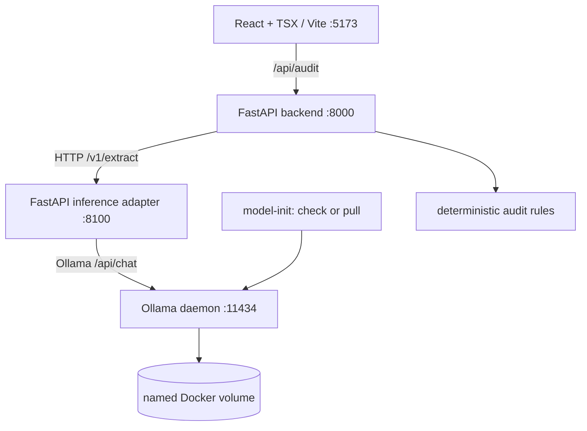

# Nursing Record Quality Lab — Local LLM × FastAPI × React/TSX

**面接・技術検証用の最小アプリ**。実在する患者・診療データを投入しないでください。臨床判断・記録修正に使用できません。

## なぜ作るのか（面接での説明順序）

1. **Webエンジニアとの共通言語を確認する**: React/TSX、API設計、FastAPI、Pydantic、Docker Compose、テスト・サービス分離。
2. **対象事業への理解を示す**: 構造化記録の「未記録」「明示的否定」「不一致」を分け、自由記述との整合性を検証する。実サービスで同じ課題・未実装機能があると断定しない。
3. **研究・数理的な強みを示す**: ルールベース対LLM、誤検出・見逃し・証拠照合・レイテンシを測る。欠測メカニズムや施設間バイアスに発展できる。
4. **クラウド設計能力を示す**: コードと推論基盤を疎結合にし、AWS/GCPで別々に配置・更新できる設計とする。

## 起動

Docker Engine と Docker Compose v2 を用意してから:

```bash
cp .env.example .env   # optional
# 初回はqwen3:0.6bをOllamaサーバーが取得する。モデル保存領域は名前付きvolume。
docker compose up --build
```

- UI: http://localhost:5173
- Backend OpenAPI: http://localhost:8000/docs
- 本番データは投入しない。例は架空の看護記録。
- モデルが不要ならUIで **ルールベースのみ** を選べる（ただしCompose全体の初回起動はモデル取得を待つ）。
- `docker compose down` はモデルを残し、`docker compose down -v` はモデルvolumeを削除する。
- Ollamaコンテナと推論コンテナのポートはホストに公開していない。

## サービス構成



| Service | Responsibility | Cloud deployment |
|---|---|---|
| `frontend` | UI, note form, status comparison, JSON inspection | Static storage + CDN / standalone frontend container |
| `backend` | Data validation, audit rules, provider-independent orchestration, REST API | ECS Fargate / Cloud Run |
| `inference` | `/v1/extract` contract, model provider adaptation, evidence guard | Private inference service; swap runtime independently |
| `ollama` | Local model runtime | ECS on EC2 for GPU / GPU-enabled Cloud Run architecture with a different packaging |
| `model-init` | Pulls model if missing once per deployment start | **Local-only lifecycle**; in production pre-stage/pin model artefacts |

BackendはOllamaの固有APIを直接知らず、`INFERENCE_URL` だけを参照する。クラウドでは推論内部実装をvLLM等に置き換えてもAPI契約が同じならWeb/API部分は変更しなくてよい。

## 動作例

1. 構造化記録で **転倒 = 未記録**、ふらつき/介助=ありを選択。
2. 架空の自由記述「歩行時ふらつきあり。移乗時は看護師が介助。転倒は認めず。」を入力。
3. 「転倒=なし」の表現が検出され、転倒の構造化記録が未記録である**確認候補**を表示。
4. ルールベースとLLMの結果を比較。モデルの誤読、根拠不一致を確認する。

異常なしは「品質保証」を意味せず、医療安全上の判定には使用しない。

## API契約

- Public: `POST /api/audit`
- Private: `POST /v1/extract`
- Health: `GET /health/live`
- Schema: `backend/app/schemas.py`, `inference/app/main.py`
- 詳細: [docs/contracts.md](docs/contracts.md)

### APIの使い方（モデル不要のテスト）

```bash
curl -X POST http://localhost:8000/api/audit \
  -H 'Content-Type: application/json' \
  -d '{"record":{"fall_status":"unknown","dizziness_status":"present","assistance_status":"present"},"narrative":"歩行時ふらつきあり。移乗時は看護師が介助。転倒は認めず。","use_llm":false}'
```

## テスト・評価（Dockerなしでも実行）

```bash
python -m pytest -q backend/tests
python -m pytest -q inference/tests
python scripts/evaluate_baseline.py
python scripts/check_compose.py  # requires PyYAML
```

ルールベースの合成例は数件のみ。精度を一般化できず、実データでの臨床性能評価ではない。

## ビルド単位

```bash
docker build -t nrl-backend:dev ./backend
docker build -t nrl-inference:dev ./inference
docker build --target production \
  --build-arg VITE_API_BASE_URL=https://YOUR_API_DOMAIN/api \
  -t nrl-frontend:dev ./frontend
```

ローカル環境ではVite proxy経由で `/api` をFastAPIに転送する。本番でCDNから別オリジンAPIを呼ぶ場合、`VITE_API_BASE_URL` を**ビルド時**に指定し、APIの `CORS_ORIGINS` と認証・TLSを適切に構成すること。

## クラウド設計

- [AWS設計・配置案](deploy/aws/README.md)
- [GCP設計・配置案](deploy/gcp/README.md)
- [論理アーキテクチャと責務](docs/architecture.md)
- [R&D評価のロードマップ](docs/experiment.md)

**注意**: 同梱は動作可能なローカル設計とクラウド向け配置設計です。AWS/GCPのアカウント・VPC・IAM・ドメイン・TLS等を含む全自動本番デプロイIaCは未実装です。認証/権限・監査・保護規制への対応を行うまでは本番運用不可です。
