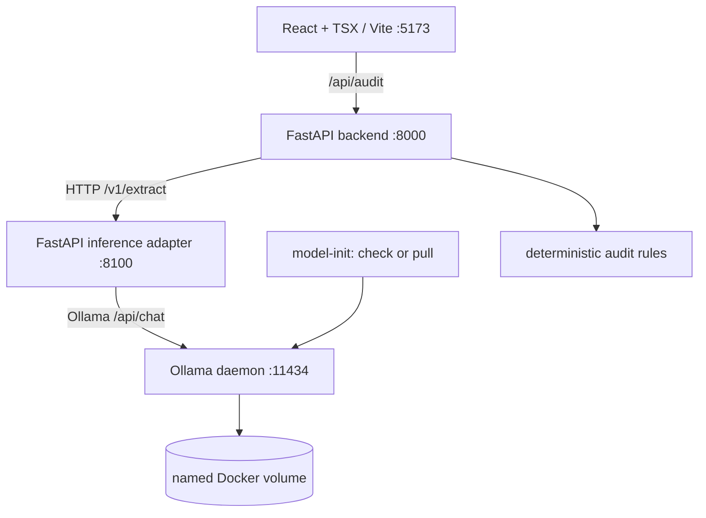

# Nursing Record Quality Lab — v1.6（AWS/GCP IaC scaffold追加） — Local LLM × FastAPI × React/TSX

**技術検証用の最小アプリ**。実在する患者・診療データを投入しないでください。臨床判断・記録修正に使用できません。

## なぜ作るのか（面接での説明順序）

1. **Webエンジニアとの共通言語を確認する**: React/TSX、API設計、FastAPI、Pydantic、Docker Compose、テスト・サービス分離。
2. **対象事業への理解を示す**: 構造化記録の「未記録」「明示的否定」「不一致」を分け、自由記述との整合性を検証する。実サービスで同じ課題・未実装機能があると断定しない。
3. **研究・数理的な強みを示す**: ルールベース対LLM、誤検出・見逃し・証拠照合・レイテンシを測る。欠測メカニズムや施設間バイアスに発展できる。
4. **クラウド設計能力を示す**: コードと推論基盤を疎結合にし、AWS/GCPで別々に配置・更新できる設計とする。


## AWS/GCPのモックIaCとデプロイ前チェック（今回追加）

**v1.6はIaC・ドキュメントのみの追加で、v1.5アプリの動作コードは変更せず**、`deploy/` 配下にTerraformサンプルとクラウド別チェックリストを追加しました。
**Terraformの実適用・AWS/GCP上の動作確認は未実施**です。実患者データを投入しないでください。

| クラウド | Terraform | デプロイ前チェック | 主な構成 |
|---|---|---|---|
| AWS | [`deploy/aws/`](deploy/aws/) | [`deploy/aws/DEPLOY_CHECKLIST.md`](deploy/aws/DEPLOY_CHECKLIST.md) | S3+CloudFront、Fargate backend/inference、Cloud Map、Ollamaサイドカー |
| GCP | [`deploy/gcp/`](deploy/gcp/) | [`deploy/gcp/DEPLOY_CHECKLIST.md`](deploy/gcp/DEPLOY_CHECKLIST.md) | Cloud Run frontend/backend/inference、IAM ID token、Ollamaサイドカー |

推論用モデルはローカルでは `model-init` で自動取得しますが、クラウドのスケール時にはモデルpullせず、[`deploy/shared/ollama/`](deploy/shared/ollama/) で**モデルを事前配置したイメージ**を使用する設計例です。

`terraform plan` / `terraform validate` の例は各クラウドのREADMEに記載。IaCの検証範囲は [`docs/iac_validation.md`](docs/iac_validation.md) に明記。`terraform apply` は実費を発生させる可能性があり、コードも本番セキュリティ未対応です。

## v1.5: 実際の失敗例から改善した内容

**確認された事実:** 以前の実行PDFでは、直接表現の例ではLLMとルールが3項目一致しましたが、
「身体が左右に揺れ、看護師が腕を支え、床に倒れなかった」という言い換え例では、
ルールが3項目 `unknown`、LLM生判定が3項目 `absent` でした。
LLMの意味抽出誤りと根拠照合による保留を切り分ける必要があります。

**変更点（モデルを差し替えず比較可能）:**

1. **LLMのプロンプトを3条件から選択:** `basic` は従来相当、`semantic` は「転倒／歩行不安定／介助」の操作的定義を追加、`few_shot` はさらに架空の例を2件追加。UI上で選択できます。デフォルトは `semantic`。
2. **誤解しやすいフィールド名の注意:** API名 `dizziness_status` は互換性維持のため残し、実際は **歩行不安定性** であって、めまいの自覚症状ではない、と指示します。将来の契約変更時に `gait_unsteadiness_status` への変更を検討します。
3. **3層の分離:** `raw_extraction` はモデルの生判定、`evidence_checks` は原文引用の**文字列一致**（意味的な妥当性の証明ではない）、`extraction` / `flags` は監査採用値。ルールからの根拠補完は `rule_supported` と明記します。
4. **重複候補をUIで統合:** 同じ転倒の問題をルール/LLMが見つけても1件と表示し、検出元の両方を表示します。APIは研究比較のためそれぞれ保持します。
5. **24件の合成評価データ:** `sample_data/evaluation_cases.json` に言い換え・否定・未言及・めまいと歩行不安定の差などを収録。実データは不使用です。

### 推奨する確認手順

```bash
# v1.4 などを動かしている場合は停止（データボリュームを消さない）
docker compose down
# v1.5 のディレクトリで起動。初回だけモデルを取得
docker compose up --build -d
# アプリの動作確認
curl http://localhost:8000/api/inference/status
# Docker起動なしで合成24件のルール性能だけ評価
python scripts/evaluate_rule_synthetic.py
# 起動中のサービスを使って同じ24件のLLMプロンプト3条件を比較
python scripts/evaluate_models.py --variants basic semantic few_shot --output results/synthetic_metrics.json
```

LLM推論の評価はCPU環境では時間がかかるため、まず次のように3例ずつ確認できます。

```bash
python scripts/evaluate_models.py --variants basic semantic few_shot --limit 3
```

モデルの精度改善は**この配布物だけでは未実証**です。`temperature=0`に固定していますが、実行環境による再現性・信頼区間も検証していません。
合成データを見ながらプロンプトを改良した場合、このデータを独立holdoutとして扱えません。別途未知データで評価してください。

### v1.5で実施したオフライン評価（合成24件のみ）

| 指標 | ルールベース |
|---|---:|
| 状態判定Accuracy（72フィールド） | 75.0% |
| 状態判定Macro F1（present/absent/unknown） | 0.6947 |
| 監査候補Precision | 1.0000 |
| 監査候補Recall | 0.4706 |

結果は `python scripts/evaluate_rule_synthetic.py` で再現できます。**LLMの数字ではありません**。

---

## v1.4: LLMの判定保留と検出結果を混同しない

v1.3では推論アダプターがモデルの判定を根拠文字列との完全一致がないだけで `unknown` に上書きしていました。また、モデルが全項目 `unknown` を返しても「確認候補0件」と表示されていました。

- 推論アダプターはモデルの生のステータスを保持（必須フィールド欠落は `invalid_model_output` として検知）。
- Backendが原文引用を検証。LLMとルールが同じ状態を認識した場合のみ、ルールの根拠を補完し `rule_supported` と表示。直接引用の場合は `quoted`。
- 根拠不明・結果不一致の場合は `unknown` （**判定保留**）とし、理由を `evidence_checks` に保持。
- LLMを使う場合も、独立した `baseline_flags` を表示するため、LLMが失敗してもルール由来の確認候補は隠れません。
- UIの「生の出力と根拠確認」で、モデルが `unknown` と答えたのか、根拠照合で保留になったのかを区別できます。

**注意:** ルールによる根拠補完はモデル出力を独立に検証できたことを意味しません。評価では `quoted` と `rule_supported` を別集計する必要があります。このPoCの抽出品質は医療用途に検証されていません。

## 起動

Docker Engine と Docker Compose v2 を用意してから:

```bash
cp .env.example .env   # optional
# 初回はmodel-initがqwen3:0.6bを取得する。モデル保存領域は名前付きvolume。
docker compose up --build
```

- UI: http://localhost:5173
- Backend OpenAPI: http://localhost:8000/docs
- 本番データは投入しない。例は架空の看護記録。
- モデルが不要ならUIで **ルールベースのみ** を選べる。モデル取得中・取得失敗時もWeb/API起動はブロックされない。
- `docker compose down` はモデルを残し、`docker compose down -v` はモデルvolumeを削除する。
- Ollamaコンテナと推論コンテナのポートはホストに公開していない。

## v1.3で修正した自動ダウンロード

v1.2では `model-init` のシェルの条件分岐を `entrypoint: ["/bin/sh", "-ec"]` と文字列 `command:` の組合せで記述していました。Composeのコマンド文字列の引数解釈に依存するため、モデル初期化が実行されない可能性がありました。v1.3では `scripts/model-init.sh` を読み取り専用マウントし、シェルスクリプトとして確実に実行します。

- `ollama show "$MODEL_NAME"` が成功する場合、pullしません。
- 存在しない場合は `ollama pull "$MODEL_NAME"` して、取得後にもう一度 `show` で確認します。
- ダウンロードの失敗時は非ゼロ終了し、`docker compose logs model-init` に原因が出るようにします。
- 実際のモデル保存はOllamaサービス側のnamed volume (`ollama_models`) で行われ、再起動しても通常保持されます。
- `model-init` は起動完了を他サービスの前提としないため、失敗してもルールモードは利用できます。

v1.2から更新する場合（**ボリュームを削除しない**）:

```bash
docker compose down
docker compose up --build -d
docker compose ps -a
docker compose logs --tail=80 model-init
docker compose exec ollama ollama list
```

モデルが手動では取得できるのに自動取得だけ失敗する場合、初期化コンテナの引数解析・ネットワーク・実行状況を切り分けます。手動取得も失敗する場合、エラーメッセージに応じてOllamaの通信・プロキシ・証明書・空き容量を確認してください。コマンドは `docker compose` のプロジェクト直下から実行してください。

## 推論エラーの原因確認（v1.3）

このバージョンでは `GET /api/inference/status` でモデルの準備状態を確認できます。Web画面の「LLM状態」にも表示します。**`inference`のDockerヘルスチェックは`/health/live`のみ**、Ollamaのモデル準備確認は`/health/ready`で独立して実施します。`backend`は`inference`の正常起動を待たずに起動するため、ルールベース監査を使用できます。

```bash
# プロジェクト直下で実行
docker compose up --build -d
# 1) コンテナの起動状況
docker compose ps
# あるいは bash scripts/diagnose.sh で一括確認
# 2) モデル一覧 (qwen3:0.6b があるか)
docker compose exec ollama ollama list
# 3) モデル取得・推論ログ
docker compose logs --tail=100 model-init inference ollama
# 4) Backend経由の推論準備状態
curl -s http://localhost:8000/api/inference/status
```

モデルがなく初回ダウンロードに失敗した場合:

```bash
# 即時の手動復旧（最も確実）
docker compose exec ollama ollama pull qwen3:0.6b
docker compose exec ollama ollama list
# 自動取得処理を明示的に再実行する場合
docker compose run --rm model-init
```

**注意:** `docker compose down -v` はモデルの保存ボリュームを消去するため、通常のトラブルシューティングでは実行しないでください。

状態チェックはOllama `/api/tags` に指定モデルが登録されたことを検査します。**モデルがメモリにロードできることや推論が成功することまでは保証しません**。推論失敗時には画面に `model_timeout`, `model_runtime_error`, `invalid_model_output` などに応じた案内を表示します。詳細は `inference` と `ollama` のログを参照してください。個人情報を含む実データを入力しないでください。

## v1.3の起動順制御の考え方

- `model-init` は Ollama の起動（healthy）後にモデルが未取得なら `pull` します。ダウンロード失敗はモデルの利用不可としてUIに表示されますが、他サービスの起動は止めません。
- `inference` の Docker healthcheck は `GET /health/live` にのみ依存し、Ollama のモデル有無では `unhealthy` にしません。
- `backend` は `inference` と起動時に依存しません。`use_llm: false` なら独立して動作します。
- `frontend` は `backend` の `/health/live` が正常になったら起動します。
- `/health/ready` は推論できる**前提条件**（Ollamaとの接続およびモデルの登録）を検証するだけで、実推論成功やメモリ容量までは保証しません。

初回のダウンロード中はLLM状態が一時的に「利用不可」と表示される場合があります。ダウンロード完了後、画面の**再確認**ボタンで更新してください。

モデル取得が失敗した場合は、`docker compose logs --tail=100 model-init ollama` を確認し、`docker compose run --rm model-init` を実行してください。v1.3では `model-init` を独立した `scripts/model-init.sh` に変更し、シェルの条件分岐がComposeのコマンド解析に左右されないようにしました。モデル保存領域を削除するため、診断目的で `docker compose down -v` は実行しないでください。

### ローカル確認コマンド

```bash
# コンテナと終了済みジョブも表示
docker compose ps -a
# 推論コンテナが起動しているか（依存サービスとは独立）
docker compose exec -T inference python -c "import urllib.request; print(urllib.request.urlopen('http://localhost:8100/health/live').read().decode())"
# モデルが登録済みか
docker compose exec -T ollama ollama list
# 正確な失敗理由
docker compose logs --tail=100 model-init inference ollama
# UIなしでルールベースAPIを確認
curl -X POST http://localhost:8000/api/audit -H 'Content-Type: application/json' -d '{"record":{"fall_status":"unknown"},"narrative":"転倒なし。","use_llm":false}'
```

## サービス構成



| Service | Responsibility | Cloud deployment |
|---|---|---|
| `frontend` | UI, note form, status comparison, JSON inspection | Static storage + CDN / standalone frontend container |
| `backend` | Data validation, audit rules, provider-independent orchestration, REST API | ECS Fargate / Cloud Run |
| `inference` | `/v1/extract` contract, model provider adaptation, evidence guard | Private inference service; swap runtime independently |
| `ollama` | Local model runtime | ECS on EC2 for GPU / GPU-enabled Cloud Run architecture with a different packaging |
| `model-init` | Pulls model if missing once per deployment start | **Local-only lifecycle**; in production pre-stage/pin model artefacts |

BackendはOllamaの固有APIを直接知らず、`INFERENCE_URL` だけを参照する。クラウドでは推論内部実装をvLLM等に置き換えてもAPI契約が同じならWeb/API部分は変更しなくてよい。

## 動作例

1. 構造化記録で **転倒 = 未記録**、ふらつき/介助=ありを選択。
2. 架空の自由記述「歩行時ふらつきあり。移乗時は看護師が介助。転倒は認めず。」を入力。
3. 「転倒=なし」の表現が検出され、転倒の構造化記録が未記録である**確認候補**を表示。
4. ルールベースとLLMの結果を比較。モデルの誤読、根拠不一致を確認する。

異常なしは「品質保証」を意味せず、医療安全上の判定には使用しない。

## API契約

- Public: `POST /api/audit`
- Private: `POST /v1/extract`
- Health: `GET /health/live`
- Schema: `backend/app/schemas.py`, `inference/app/main.py`
- 詳細: [docs/contracts.md](docs/contracts.md)

### APIの使い方（モデル不要のテスト）

```bash
curl -X POST http://localhost:8000/api/audit \
  -H 'Content-Type: application/json' \
  -d '{"record":{"fall_status":"unknown","dizziness_status":"present","assistance_status":"present"},"narrative":"歩行時ふらつきあり。移乗時は看護師が介助。転倒は認めず。","use_llm":false}'
```

## テスト・評価（Dockerなしでも実行）

```bash
python -m pytest -q backend/tests
python -m pytest -q inference/tests
python scripts/evaluate_baseline.py
python scripts/check_compose.py  # requires PyYAML; checks startup independence as well
```

ルールベースの合成例は数件のみ。精度を一般化できず、実データでの臨床性能評価ではない。

## ビルド単位

```bash
docker build -t nrl-backend:dev ./backend
docker build -t nrl-inference:dev ./inference
docker build --target production \
  --build-arg VITE_API_BASE_URL=https://YOUR_API_DOMAIN/api \
  -t nrl-frontend:dev ./frontend
```

ローカル環境ではVite proxy経由で `/api` をFastAPIに転送する。本番でCDNから別オリジンAPIを呼ぶ場合、`VITE_API_BASE_URL` を**ビルド時**に指定し、APIの `CORS_ORIGINS` と認証・TLSを適切に構成すること。

## クラウド設計

- [AWS設計・配置案](deploy/aws/README.md)
- [GCP設計・配置案](deploy/gcp/README.md)
- [論理アーキテクチャと責務](docs/architecture.md)
- [R&D評価のロードマップ](docs/experiment.md)

**注意**: 同梱は動作可能なローカル設計とクラウド向け配置設計です。AWS/GCPのアカウント・VPC・IAM・ドメイン・TLS等を含む全自動本番デプロイIaCは未実装です。認証/権限・監査・保護規制への対応を行うまでは本番運用不可です。

## v1.4動作確認のポイント

1. 既定の架空入力を送信すると、ルールは「転倒=なし」を検出し、構造化記録が未記録であるため **ルールベース確認候補1件** になります。
2. LLM側はモデルの実際の出力に依存します。引用が正確なら判定採用、引用がなくてもルールと一致すれば `rule_supported`、それ以外は保留します。 **モデルが全項目unknownを返す場合も、ルール候補は消えません。**
3. JSONタブで `raw_extraction` と `evidence_checks` を確認できます。まずはモデルの生の出力と根拠照合で判定が変化したかを見てください。

ローカル更新（Dockerボリュームを削除しない）：

```bash
docker compose down
docker compose up --build -d
```

`docker compose down -v` を使うとモデルが再ダウンロードされるため避けてください。
