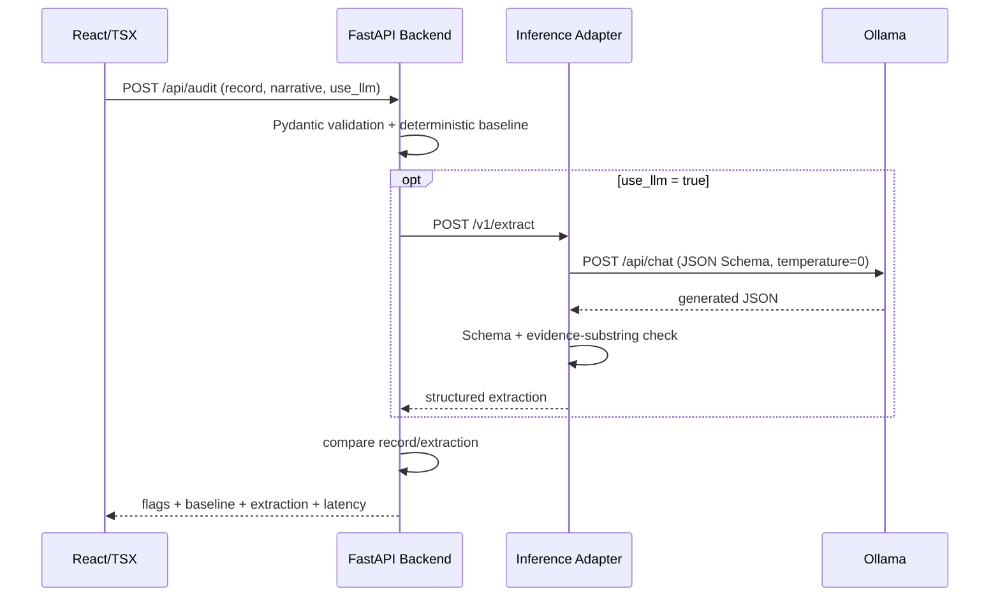

# アーキテクチャと責務

## 設計上の原則

- **UI/業務API/推論API/推論ランタイムを分離**。クラウドでは各サービスを独立して置き換えられる。
- **同一クラウド前提のコードを混ぜない**。配置先の違いは環境変数 (`INFERENCE_URL`, `INFERENCE_AUTH_MODE`, `OLLAMA_URL`) とデプロイ設定で吸収。
- `backend/app/rules.py` は純粋なルールベース関数であり、Ollama/GCP/AWS依存を持たない。
- `backend/app/inference_client.py` のHTTP境界で、バックエンドの抽出方式を切り替える。
- **UIは推論ランタイムに直接接続しない**。PII流出や内部API露出を避ける。
- 応答は発見候補。**負の観察(absent)** と **未記録(unknown)** を区別する。

## 内部フロー

## 設定と契約

| Boundary | Contract | Auth | Timeout |
|---|---|---|---|
| Browser → Backend | `POST /api/audit`, browser JSON | **local only no auth**; cloud requires OIDC/identity proxy | frontend browser default |
| Backend → Inference | `POST /v1/extract`, JSON | local private Docker network; optional GCP ID token mode | configurable `INFERENCE_TIMEOUT_SECONDS` |
| Inference → Ollama | `POST /api/chat`, model-specific JSON | internal runtime; no external exposure | 115s in demo |

## クラウドへの置換単位

- Frontend: React の成果物 `dist/` を CDNに配置するか、nginx を独立コンテナとして展開。
- Backend: Stateless コンテナ。`INFERENCE_URL` の差し替えだけで、サービス発見先を変更。
- Inference: `/v1/extract` の互換APIを保ちつつ、Ollama以外に移行可能。
- Ollama: ローカルデモの実装詳細。クラウドGPUへ移行する際、モデル重み事前配置/ストレージと起動時ロードの方針が必要。
- DB: **現段階ではない**。不要なデータ保持を避ける。今後必要なら専用StorageAdapterを新設。
- Async queue: **現段階ではない**。長いバッチ処理が必要になってからSQS/Cloud Tasksを追加。

## 将来の実システム移行時の必須要件

- 認証・認可、最小権限、TLS、private ingress、必要な場合はVPN/閉域網。
- PHI/個人情報の保持・転送の可否について法令・病院契約・ガイドラインを確認。
- ログは本文・患者識別情報を収集しない。構造化メトリクスのみで分析する。
- 推論サービスのレート制御、タイムアウト・サーキットブレーカー・バックプレッシャー。
- モデル/プロンプト/正解セットのバージョン固定と再現性。
- `health/live` は**プロセス生存**チェック。Ollama/モデルreadyを保証しない。必要なら別 `/health/ready` を設ける。
- `unknown` は判断保留であり、文字列検出器でもLLMでも検証しないかぎり「ない」と結論づけない。

## このサンプルの非対応範囲

本番認証/IaC、臨床監査ワークフロー、正式な看護記録更新、永続DB、SLA、複数施設データの統合、負荷試験、プライバシー影響評価。意図的に含めていない。
